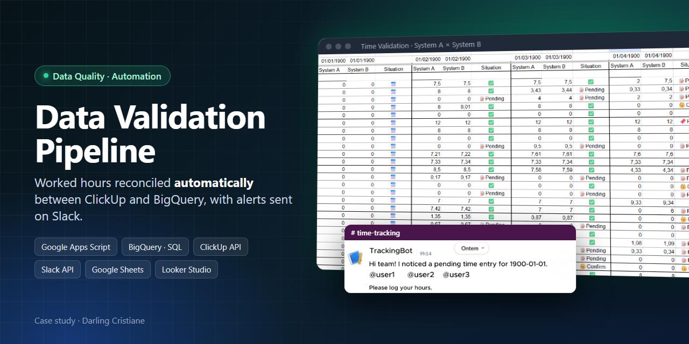
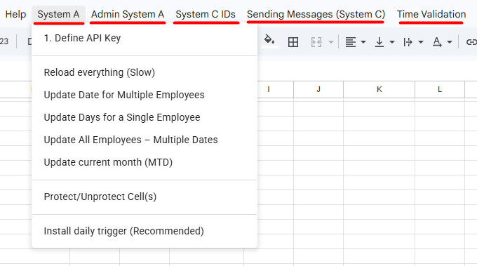
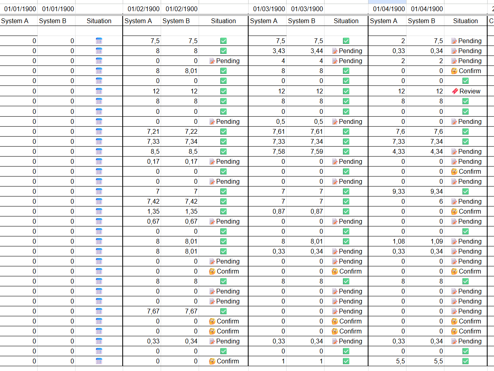
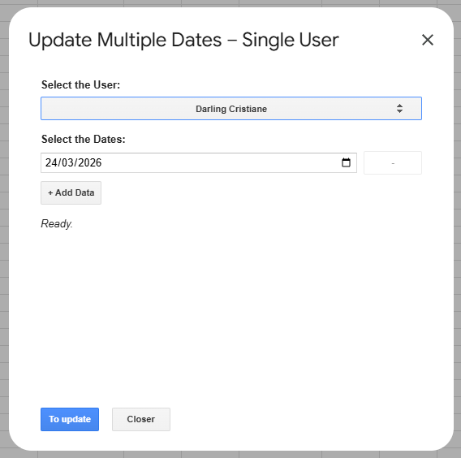
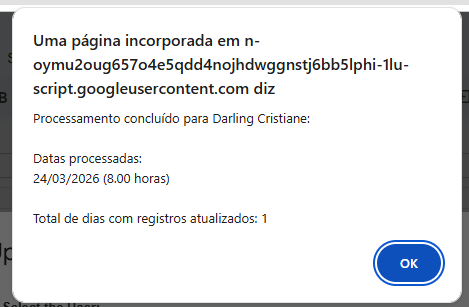

# 📊 Data Validation & Time Tracking Automation

🇬🇧 **English** · 🇧🇷 [Português](README.pt.md)



**Portfolio / case study:** https://smart-validation-hub.lovable.app/

## 🚀 Overview

This project is a **data validation and automation pipeline** built using Google Apps Script.
It was designed to streamline time tracking processes, ensure data consistency, and automate operational workflows.

The system integrates spreadsheet data, user interaction interfaces, and automated validation logic to improve reliability and efficiency in time reporting.

---

## 🎯 Problem

Manual time tracking processes often lead to:

* Inconsistent data across systems
* Missing or incomplete time entries
* Lack of visibility for pending actions
* Time-consuming manual verification

This project addresses these issues by providing automated validation, batch updates, and reminder workflows.

---

## 🧠 Solution

The system introduces:

* ✅ Automated validation of time entries
* 👥 Multi-user batch processing
* 📅 Date-based update workflows
* 🔔 Reminder system for missing entries
* 🧩 Modular UI dialogs for user interaction

---

## 🏗️ Architecture

The project is structured into three main layers:

### 1. Backend (Apps Script)

* Data processing and validation logic
* Spreadsheet read/write operations
* Mock API integration for demonstration purposes

### 2. Frontend (HTML Dialogs)

* User-friendly interfaces for:

  * Selecting employees
  * Updating multiple users
  * Sending reminders
* Built using Google Apps Script HTML Service

### 3. Data Layer

* Spreadsheet-based storage
* Structured headers and validation columns

---

## 📁 Project Structure

```
data-validation-pipeline/
│
├── validationPipeline.js
├── multiUserDialog.html
├── bulkUpdateDialog.html
├── dialog.html
├── trackingbot.png
├── README.md
├── README.pt.md
└── screenshots/
```

---

## ⚙️ Features

### 🔍 Data Validation

* Compares tracked hours across sources
* Flags inconsistencies and missing data

### 👥 Multi-User Updates

* Select multiple users
* Apply updates to specific dates

### 📅 Bulk Date Processing

* Update multiple dates simultaneously
* Optimized for batch operations

### 🔔 Reminder System

* Detects pending entries
* Triggers notification workflow (mocked for security)

---

## 🔐 Security & Privacy

This repository contains a **sanitized version** of the original system.

For security reasons, the following elements were removed or replaced:

* API tokens and credentials
* Webhooks and external endpoints
* Internal system identifiers
* Real user data

All integrations are represented using **mock data** to demonstrate architecture without exposing sensitive information.

---

## 🛠️ Technologies

* Google Apps Script
* JavaScript (ES6+)
* HTML / CSS
* Spreadsheet Automation

---

## 📸 Screenshots

### Spreadsheet menu
All routines live in a custom menu inside the spreadsheet: updating dates, protecting cells, installing the daily trigger and sending messages.



### System A × System B validation
For each person and each day, the spreadsheet compares the hours from both systems and flags the status: ✅ ok, Pending, Confirm or Review.



### Updating multiple dates
Dialog to update several dates for one user at once, with a summary of what was processed.





### Slack reminders
Choosing the dates and sending an automatic Slack reminder to anyone with a pending time entry.


---

## 🧪 How It Works

1. User opens the interface from the spreadsheet
2. Selects employees or dates
3. System processes data in the backend
4. Validation rules are applied
5. Updates and logs are written to the sheet
6. (Optional) Reminder workflow is triggered

---

## 💡 Key Highlights

* Clean separation between UI and logic
* Modular and scalable structure
* Designed for real-world operational use
* Secure by design (no exposed credentials)

---

## 📈 Future Improvements

* Real API integration with secure token handling
* Retry and error recovery mechanisms
* Performance optimization for large datasets
* Logging and monitoring system

---

## 👨‍💻 Author

Developed as part of a real-world automation workflow, adapted for portfolio demonstration.

---

## 📬 Contact

Feel free to connect or reach out for collaboration opportunities.
