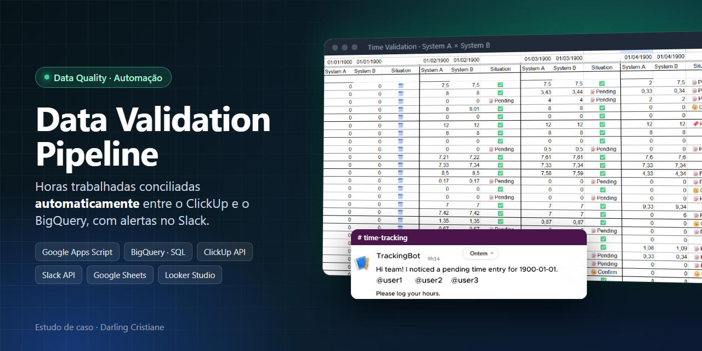
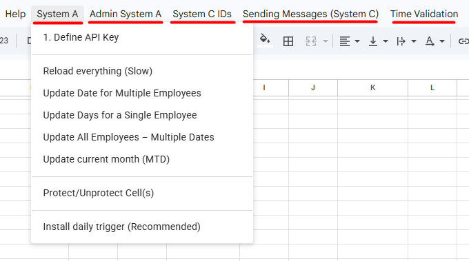
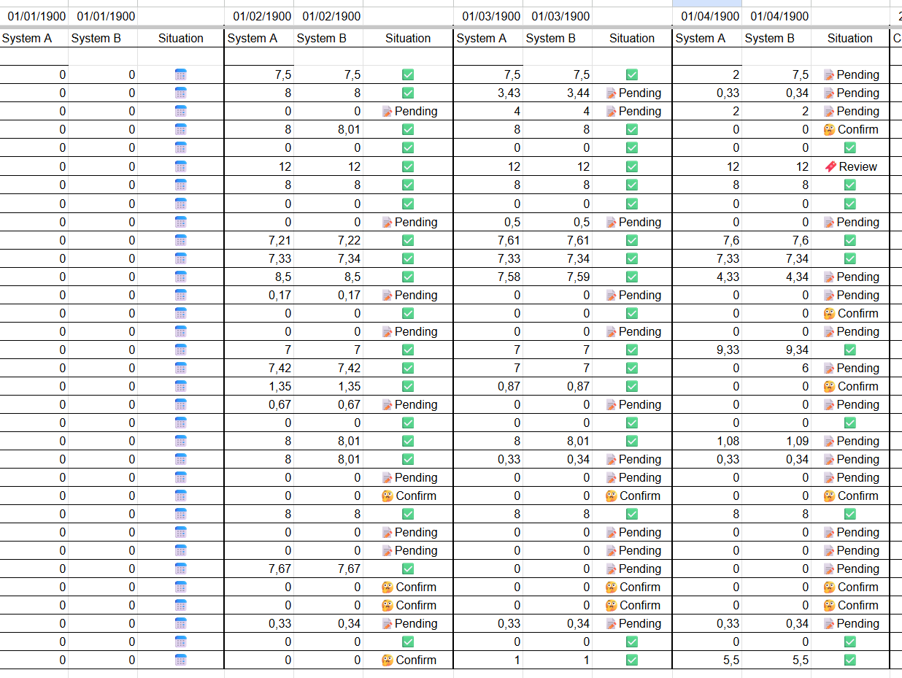
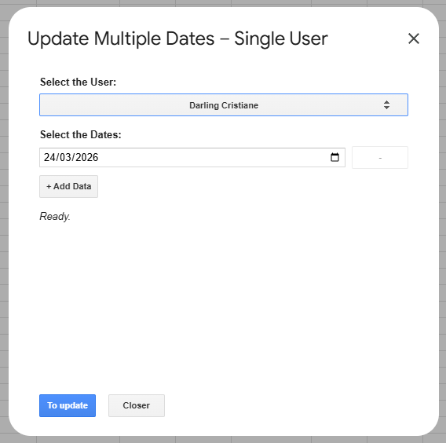
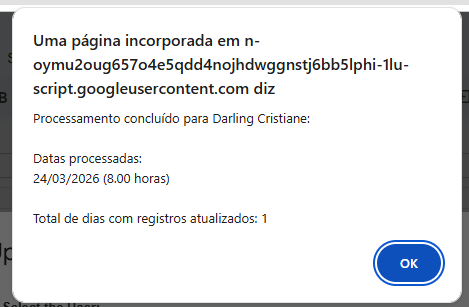

# 📊 Validação de Dados e Automação de Apontamento de Horas

🇬🇧 [English](README.md) · 🇧🇷 **Português**



**Portfólio / estudo de caso:** https://smart-validation-hub.lovable.app/

## 🚀 Visão geral

Este projeto é um **pipeline de validação de dados e automação** construído em Google Apps Script.
Ele foi criado para simplificar o processo de apontamento de horas, garantir a consistência dos dados e automatizar fluxos operacionais.

O sistema junta os dados da planilha, telas de interação com o usuário e regras automáticas de validação para tornar o apontamento de horas mais confiável e eficiente.

---

## 🎯 Problema

Processos manuais de apontamento de horas costumam gerar:

* Dados inconsistentes entre sistemas
* Apontamentos faltando ou incompletos
* Pouca visibilidade do que está pendente
* Conferência manual demorada

Este projeto resolve esses pontos com validação automática, atualização em lote e lembretes.

---

## 🧠 Solução

O sistema traz:

* ✅ Validação automática dos apontamentos
* 👥 Processamento em lote para vários usuários
* 📅 Atualização por data
* 🔔 Lembretes para apontamentos pendentes
* 🧩 Telas de diálogo modulares para o usuário

---

## 🏗️ Arquitetura

O projeto é organizado em três camadas:

### 1. Backend (Apps Script)

* Lógica de processamento e validação dos dados
* Leitura e escrita na planilha
* Integração com APIs simulada (mock), para demonstração

### 2. Frontend (diálogos em HTML)

* Telas simples para:

  * Escolher colaboradores
  * Atualizar vários usuários
  * Enviar lembretes
* Feitas com o HTML Service do Google Apps Script

### 3. Camada de dados

* Armazenamento em planilha
* Cabeçalhos estruturados e colunas de validação

---

## 📁 Estrutura do projeto

```
data-validation-pipeline/
│
├── validationPipeline.js
├── multiUserDialog.html
├── bulkUpdateDialog.html
├── dialog.html
├── trackingbot.png
├── README.md
├── README.pt.md
└── screenshots/
```

---

## ⚙️ Funcionalidades

### 🔍 Validação de dados

* Compara as horas apontadas entre as fontes
* Marca inconsistências e dados faltando

### 👥 Atualização para vários usuários

* Escolha de vários usuários
* Atualização em datas específicas

### 📅 Processamento de datas em lote

* Atualiza várias datas de uma vez
* Otimizado para operações em lote

### 🔔 Lembretes

* Detecta apontamentos pendentes
* Dispara o fluxo de notificação (simulado, por segurança)

---

## 🔐 Segurança e privacidade

Este repositório contém uma **versão sanitizada** do sistema original.

Por segurança, os seguintes elementos foram removidos ou substituídos:

* Tokens de API e credenciais
* Webhooks e endpoints externos
* Identificadores internos dos sistemas
* Dados reais de usuários

Todas as integrações usam **dados simulados (mock)** para mostrar a arquitetura sem expor informações sensíveis.

---

## 🛠️ Tecnologias

* Google Apps Script
* JavaScript (ES6+)
* HTML / CSS
* Automação de planilhas

---

## 📸 Telas

### Menu na planilha
Todas as rotinas ficam num menu próprio dentro da planilha: atualizar datas, proteger células, instalar o gatilho diário e enviar mensagens.



### Validação System A × System B
Para cada pessoa e cada dia, a planilha compara as horas dos dois sistemas e marca a situação: ✅ ok, Pending, Confirm ou Review.



### Atualização de várias datas
Diálogo para atualizar várias datas de um usuário de uma vez, com o resumo do que foi processado.





### Lembretes no Slack
Escolha das datas e aviso automático no Slack para quem tem apontamento pendente.


---

## 🧪 Como funciona

1. O usuário abre a tela a partir da planilha
2. Escolhe os colaboradores ou as datas
3. O sistema processa os dados no backend
4. As regras de validação são aplicadas
5. As atualizações e os registros são gravados na planilha
6. (Opcional) O fluxo de lembretes é disparado

---

## 💡 Destaques

* Separação clara entre interface e lógica
* Estrutura modular e escalável
* Pensado para uso real na operação
* Seguro desde o projeto (nenhuma credencial exposta)

---

## 📈 Próximos passos

* Integração real com as APIs, com tratamento seguro de tokens
* Novas tentativas e recuperação de erros
* Otimização de desempenho para grandes volumes de dados
* Sistema de logs e monitoramento

---

## 👩‍💻 Autora

Desenvolvido a partir de um fluxo real de automação e adaptado para portfólio.

---

## 📬 Contato

Fique à vontade para se conectar ou entrar em contato para oportunidades de colaboração: [LinkedIn](https://www.linkedin.com/in/darling-cristiane-56130221a/) · [GitHub](https://github.com/Darlingcris)
